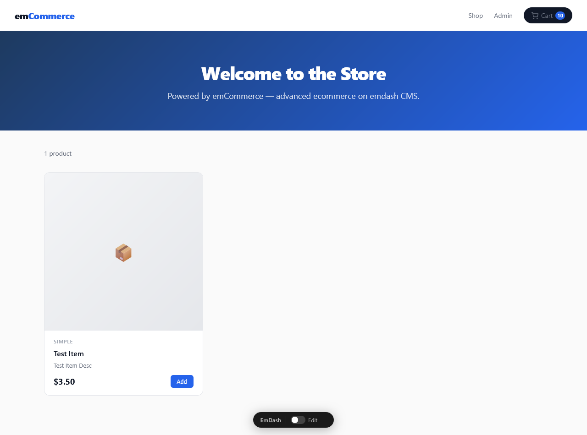
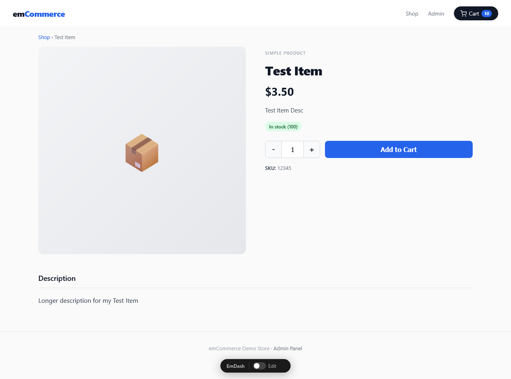
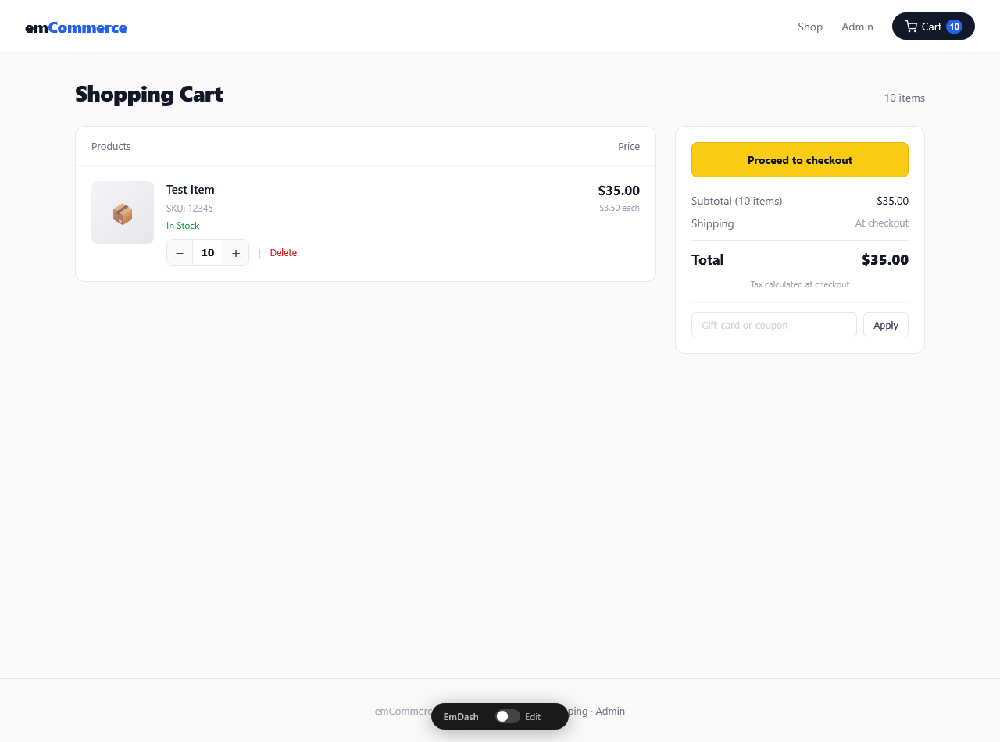
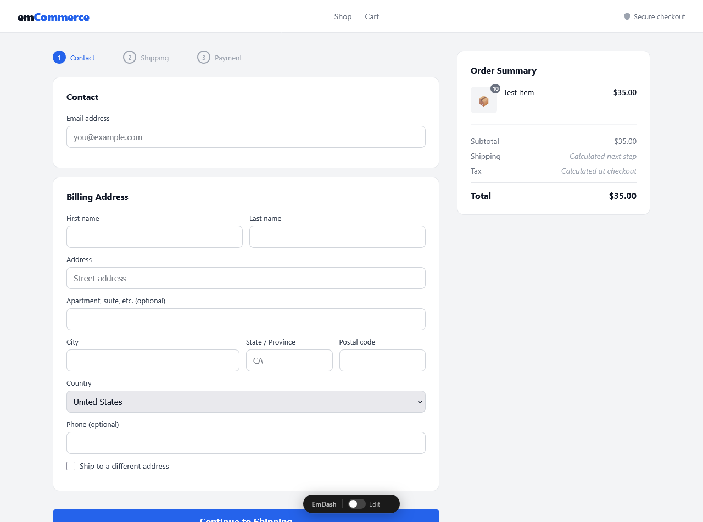
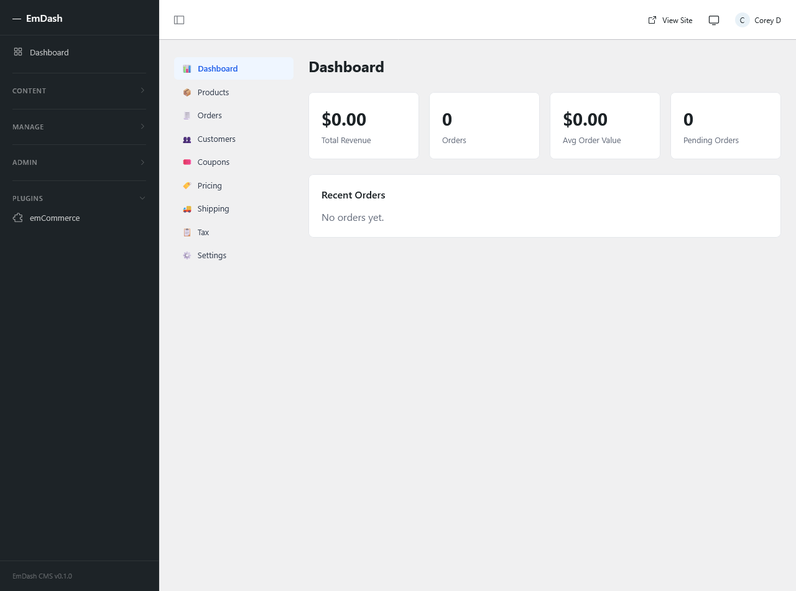
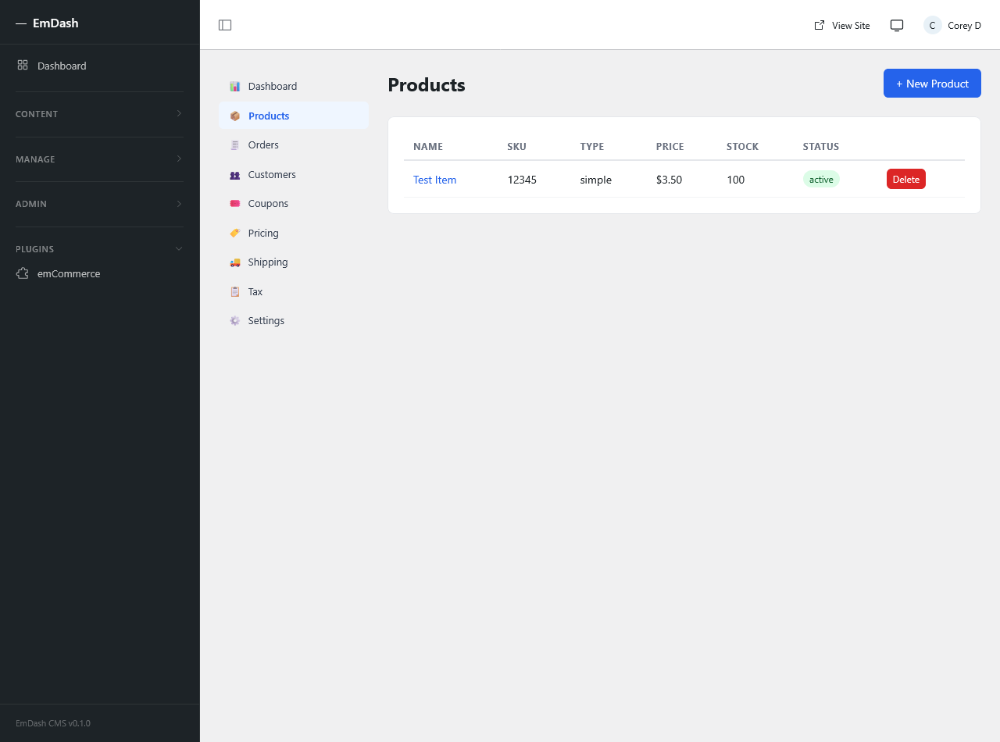
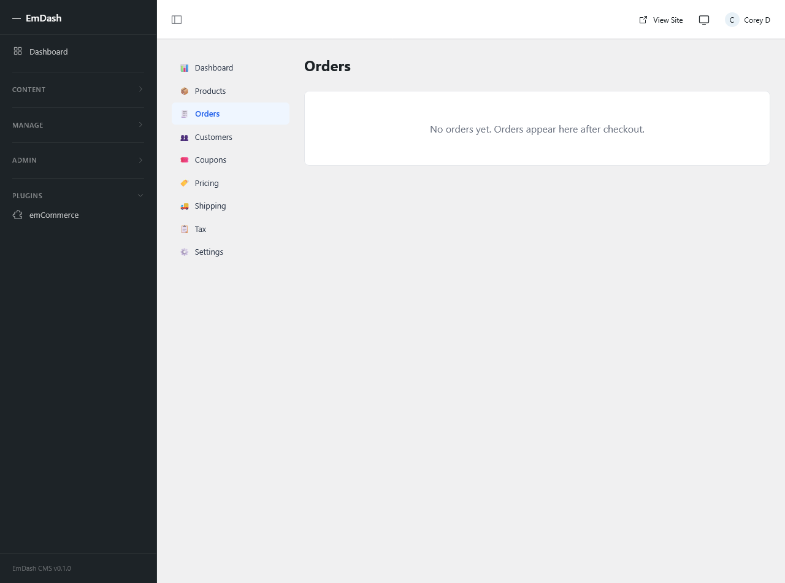
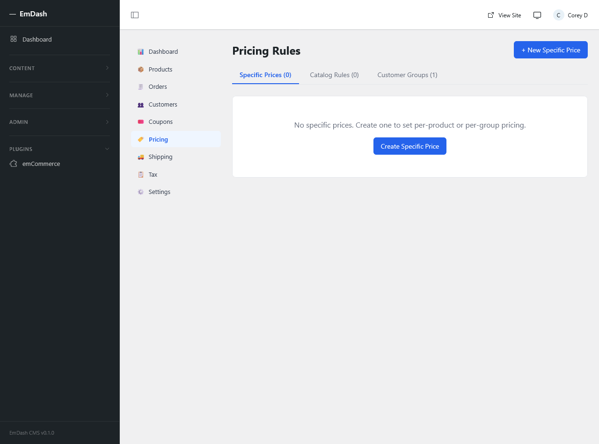

# emCommerce

> An AI wrote [emdash](https://github.com/emdash-cms/emdash). Then an AI wrote a plugin for it. You're looking at the result — two AIs doing their best, no human feelings were hurt in the making of this software.

**emCommerce** is a full-featured eCommerce plugin for [emdash CMS](https://github.com/emdash-cms/emdash). It brings advanced eCommerce capabilities — group pricing, catalog rules, quantity breaks, per-customer overrides, and a full checkout flow — to the emdash ecosystem, built on Astro 6+ and SQLite.



---

## Features

### Storefront
- **Product listing page** — grid layout, add-to-cart, price display, stock badge
- **Product detail page** — image gallery, quantity selector, in-stock indicator, SKU, description
- **Shopping cart** — server-side cart with quantity updates, line item delete, coupon code input, subtotal/total summary
- **Checkout** — 3-step flow (Contact → Shipping → Payment) with sticky order summary sidebar
- **Order confirmation** — post-purchase page with order number, item list, and totals

### Admin
- **Dashboard** — sales overview widget, recent orders, low stock alerts
- **Products** — full CRUD with type (simple/variable/virtual/downloadable/external), SKU, pricing, stock management, categories, tags, tax class, custom fields
- **Orders** — order list with status badges, status transitions, refund support, admin notes
- **Customers** — customer profiles with group assignment, custom fields, address book
- **Coupons** — percentage, fixed cart, fixed product, free shipping, and BOGO types; usage limits, date ranges, stacking rules
- **Pricing Rules**
  - *Specific Prices* — per-product/per-group/per-customer overrides with priority and specificity tiebreaker
  - *Catalog Rules* — category, tag, attribute, and price-range condition builder with AND/OR logic
  - *Customer Groups* — group management with default group auto-seeding
- **Shipping** — zone-based flat-rate methods; extensible `ShippingProvider` interface for live-rate carriers (ShipEngine built-in)
- **Tax** — tax classes, per-country/state rules, tax-inclusive pricing toggle
- **Settings** — tabbed: General (store info, custom field definitions), Payments (Stripe, PayPal, ShipEngine keys with masked display), API Keys (create/revoke with scoped permissions)

### Payments
- **Stripe** — Elements card UI, `confirmCardPayment` flow, webhook handler
- **PayPal** — JS SDK buttons, `createOrder`/`onApprove` flow
- Extensible `PaymentGateway` interface for additional providers

### Architecture
- All money stored as **integer cents** — no floats
- **Server-side cart** with session binding and expiry
- **Snapshot-on-order** — prices and product names copied at order time, immutable to catalog changes
- **KV for settings**, `StorageCollection` for entities — no raw SQL
- **Custom fields** on products, orders, and customers — definable in Settings
- **API keys** with SHA-256 hashing, scoped permissions, prefix display (`emck_...`)

---

## Installation

```bash
npm install @emdash-cms/plugin-emcommerce
```

```ts
// astro.config.mjs
import { emCommercePlugin } from "@emdash-cms/plugin-emcommerce";

export default defineConfig({
  integrations: [
    emdash({
      plugins: [
        emCommercePlugin({ defaultCurrency: "USD" }),
      ],
    }),
  ],
});
```

Add storefront pages to your Astro project:

```
src/pages/shop/
  index.astro         ← product listing
  [slug].astro        ← product detail
  cart.astro          ← cart
  checkout.astro      ← checkout
  order-confirmation.astro
```

---

## TODO / Work in Progress

### Checkout & Payments
- [ ] **Checkout does not complete** — Stripe `confirmCardPayment` and PayPal `onApprove` flows are wired up but untested end-to-end; no live keys configured in demo
- [ ] PayPal SDK URL needs real `client-id` query param to load
- [ ] No guest vs. authenticated checkout distinction
- [ ] No address validation

### Emails
- [ ] **No emails are sent** — order confirmation, shipping notification, refund confirmation, abandoned cart, and low-stock alert handlers exist but email delivery is not connected to any provider
- [ ] Email templates are defined but not rendered/sent

### Tax
- [ ] **Tax calculation is wired but not applied at checkout** — tax rules exist in the admin but the tax engine is not integrated into the checkout total in the storefront
- [ ] No VAT/GST number field
- [ ] Tax-inclusive pricing toggle exists in settings but is not enforced in price display

### Shipping
- [ ] **Live carrier rates (ShipEngine) not tested** — API key integration is built but unverified against real ShipEngine responses
- [ ] No tracking number field on orders
- [ ] Shipping weight not calculated from product weights automatically

### Pricing Engine
- [ ] Pricing cache invalidation on rule save is stubbed but not fully tested
- [ ] Quantity break display table on product page not implemented
- [ ] Multi-currency exchange rate sync cron exists but UI for managing rates is minimal

### Setup Wizard
- [ ] **Not implemented** — the 6-step onboarding wizard (store profile → product types → payments → shipping → tax → launch) is planned but not built; stores go straight to the admin

### Customers
- [ ] No customer account portal (order history, saved addresses)
- [ ] Customer registration/login on storefront not implemented
- [ ] Guest checkout does not create a customer record

### Orders
- [ ] No printable invoice/packing slip
- [ ] Bulk order status updates not implemented
- [ ] Order export (CSV) not implemented

### Products
- [ ] Variable products (variants) admin UI is incomplete
- [ ] Product image upload not connected to emdash media library
- [ ] Grouped and external product types not fully implemented

### General
- [ ] No automated test suite yet (pricing engine unit tests are planned)
- [ ] No setup documentation beyond this README
- [ ] Storefront CSS is inline — no theme customization system

---

## Tech Stack

- [emdash CMS](https://github.com/emdash-cms/emdash) — Astro 6+, SQLite, plugin system
- [Stripe](https://stripe.com) — payment processing
- [PayPal JS SDK](https://developer.paypal.com/sdk/js/) — PayPal checkout
- [ShipEngine](https://www.shipengine.com) — live carrier rates (optional)
- [ulidx](https://github.com/perry-mitchell/ulidx) — sortable unique IDs
- [Zod](https://zod.dev) — schema validation

---

## Screenshots

### Shop


### Product Detail


### Cart


### Checkout


### Admin — Dashboard


### Admin — Products


### Admin — Orders


### Admin — Pricing Rules


---

*Built entirely by Claude. Maintained by whoever is brave enough.*
